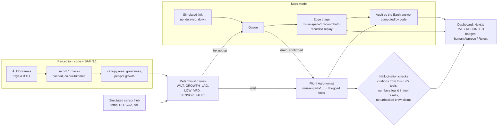

# CERES

> **Mission control for the first farm off Earth.** Built for the **Meta Global AI Developer Hackathon** (building period: Oct 27 – Nov 4, 2026).

**Repository created:** 2026-10-26. All code in this repository was written during the hackathon. See [HACKATHON.md](HACKATHON.md) for the build log and how to check that.

## Problem Statement

- [ ] **Build for Your World**: bring Meta's models into a domain we know firsthand.
- [x] **Push the Frontier**: use Meta's models on challenges in software, robotics, manufacturing, energy, materials, and beyond.

## The problem

Fresh crops will supplement astronaut diets on long missions, but crew time is scarce, a plant that wilts overnight is easy to miss, and on Mars a question to Earth takes minutes each way. A crop-health system there has to (1) measure plants itself, (2) raise alerts without a model guessing, (3) explain an alert with evidence a human can check, (4) keep working when the Earth link is down, and (5) never act on its own. CERES is a software-only prototype of that system, built on real greenhouse images with labelled, simulated faults.

## Overview

Fresh crops will supplement astronaut diets on long missions, but crew time is scarce. On Mars, a question to Earth takes minutes each way. CERES is a crop-health copilot for a spacecraft greenhouse:

- **Measures** every tray with **SAM 3.1** (canopy and per-plant masks). The numbers (area, greenness, growth) are computed by code, not guessed.
- **Detects** with deterministic rules (wilting risk, growth lag, low VPD, sensor faults). An LLM never raises an alert.
- **Investigates** each alert with a **Muse Spark** "Flight Agronomist". It calls tools, compares against the control tray, looks at frames, and returns ranked probable causes. Every piece of evidence it cites is machine-checked against what its tools actually returned.
- **Proposes, never actuates.** Recommended actions wait for a human to approve them.

## Architecture



An LLM never raises an alert and never actuates: rules raise alerts, the agent explains them, a human approves actions. In `DEMO_MODE` the two model boxes read recordings (`data/demo/agent_runs`, `data/demo/edge_runs`) through the same orchestrator and the same checks.

## Meta Models Used

| Model | Access | Role in CERES |
|---|---|---|
| `sam-3.1` | Meta Model API | Segments every tray frame into per-plant masks (text prompt "plant"). The masks feed canopy area, greenness and growth metrics. 844 frames segmented, cached so nothing is paid for twice. |
| `muse-spark-1.3` | Meta Model API | **Flight Agronomist.** A tool-calling agent that investigates alerts across sensor series, canopy metrics and tray images, and returns a strict-JSON assessment. Its citations are validated and it gets one retry. |
| `muse-spark-1.3-contributor` | Meta Model API | Mars-mode edge triage (recorded demo runs and the edge eval), plus development runs at lower cost |
| Muse Code (`muse` CLI) | Meta's coding agent | Wrote the ALED dataset fetcher (`scripts/fetch_dataset.py`) and did a read-only review of the M0 scaffold. See [MUSE_CODE.md](MUSE_CODE.md). |

Switchable: the Mars-mode edge model (`EDGE_MODE=recorded|remote_glimmer|spark_contributor`, default `recorded`). The demo replays edge runs recorded with `muse-spark-1.3-contributor` (no model runs on the habitat computer), and every badge names that model and says RECORDED. Pointing `remote_glimmer` at a hosted Glimmer endpoint is a config change.

## Model routing and cost

| Task | Model (Meta Model API) | Calls | Measured cost | Source |
|---|---|---|---|---|
| Plant segmentation | `sam-3.1` | 844 frames, cached | $1.95 for all 844 | PROGRESS.md (full SAM batch) |
| Earth-side Flight Agronomist (tools, images, strict JSON) | `muse-spark-1.3`, low reasoning effort | one run per alert | $0.103 per assessment (latest eval run) | backend/eval/out/latest.json |
| Mars-mode edge triage (3 tools, 1 image) | `muse-spark-1.3-contributor` | one run per queued alert | $0.0026 per run (latest edge eval) | backend/eval/out/latest_edge.json |
| Mars-mode audit | none: computed in code | | $0 | backend/link/audit.py |

Muse Code (`muse-spark-1.3-contributor`) wrote the dataset fetcher and reviewed the M0 scaffold; later milestone reviews were done by independent Claude Sonnet agents. The Meta spend while building is tracked in [PROGRESS.md](PROGRESS.md) (cap $150).

## What is real and what is simulated

CERES runs entirely in software, without hardware:

| Part | Status |
|---|---|
| Plant images | **Real** frames from the [Aberystwyth Leaf Evaluation Dataset](https://doi.org/10.5281/zenodo.168158): a phenotyping greenhouse, 4 trays of *Arabidopsis thaliana*, 36 days, CC BY 4.0 |
| Faults on trays B and C | **Simulated.** Tray B's frames are transformed to show wilting and tray C's are time-warped to show light-limited growth, from each tray's fault start. Labelled SIMULATED FAULT everywhere. |
| SAM 3.1 measurements | **Real** model output on those frames. The measurement is real; the input fault on B and C is simulated. |
| Sensors (temperature, RH, CO₂, soil moisture) | **Simulated** by a deterministic sensor hub, including an injected RH-sensor flatline |
| Agent assessments | **Real** Muse Spark calls. The agent is deliberately not told which inputs are simulated, so it is tested blind. |
| Mars link and light delay | **Simulated** (scaled wall-clock seconds; the real one-way delay is 3–22 min) |
| Edge triage in Mars mode | **Real model output, replayed.** Recorded with `muse-spark-1.3-contributor` through the remote API; it stands in for an on-board model. Nothing is labelled on-board. |

## What is simulated

Faults on trays B and C (image transform, low-light time-warp), every sensor reading, the tray L humidity rise, the RH-sensor flatline, the mission clock, and the Earth-Mars link and its delay. The plant images and the SAM 3.1 measurements are real; the agent is not told which inputs are simulated. Details in the table above.

## Built During the Hackathon

| Feature | Status |
|---|---|
| Virtual camera: range-request sampler for the 61.6 GB ALED archive (downloads only the frames used) | ✅ |
| Simulated faults on real frames (wilting transform, low-light time-warp), labelled throughout | ✅ |
| SAM 3.1 client: stream parsing, raw-output cache, per-image spend ledger, budget guard | ✅ |
| Simulated sensor hub (same protocol as a real one) with fault injection | ✅ |
| Deterministic rules: WILT_RISK, GROWTH_LAG, LOW_VPD_RISK, SENSOR_FAULT (with suppression) | ✅ |
| Replayable mission clock; alert episodes; no data from after the current mission time ever reaches the UI | ✅ |
| Muse Spark Flight Agronomist with 8 logged tools, citation validator, SSE streaming | ✅ |
| Mission-control dashboard (Next.js) with provenance badges, charts, frame scrubber, agent panel | ✅ |
| Validation of SAM masks against 55 ALED hand-annotated frames, with a colour-threshold baseline (shown on /trust) | ✅ |
| Evaluation harness: 11 scenarios (faults, sensor and camera failures, a contradicting crew note, prompt injection), deterministic scoring, scoreboard on /trust | ✅ |
| Mars mode: simulated Earth link (up / delayed / down) with a queue, edge triage (recorded runs by default; the badge names the model that produced them), Earth-side audit computed by code | ✅ |
| Hallucination checks: every citation must come from the run's own tools; every number in the model's prose must match a value its tools returned (durations against real elapsed times); unbacked claims of crew actions are rejected | ✅ |

## Demo

- **Demo video (3 min):** _link coming soon_ <!-- placeholder: add the GIF/video link here -->
- **Live product:** `make demo` (offline replay) or `make dev` (live, with a key)

## Quick start

**Offline demo (no `META_API_KEY`, no paid calls; after installing dependencies it runs without network).** Needs Python 3.11+ and Node 20+; `pip install` and `npm install` need network once.

```bash
python -m venv .venv && .venv/Scripts/python -m pip install -e .[dev]   # .venv/bin/python on macOS/Linux
make demo        # seeds data/demo.db, backend on :8000, dashboard on http://localhost:3000
```

Every model-backed view (agent panel, Mars cards, queue drain) is replayed from `data/demo/` and labelled **RECORDED**; the replay re-runs the citation and numeric-grounding checks. An alert without a recording answers "no recorded run for this alert in demo mode" (HTTP 409); nothing falls back to a live call. Suggested path: set the clock to 2016-01-07 12:00, open tray B, click the WILT_RISK alert, then take the link down in the header and queue alerts on `/mars`.

Without `make` (the two commands behind it, in Git Bash or a POSIX shell; in PowerShell set the variables with `$env:NAME = "value"` first):

```bash
.venv/Scripts/python scripts/seed_demo.py
DB_PATH=data/demo.db DEMO_MODE=1 EDGE_MODE=recorded IMAGES_ROOT=data/demo/frames .venv/Scripts/python -m uvicorn backend.app:app --port 8000
# second terminal
cd web && npm install && npm run dev
```

**Live (needs a key and the full dataset).** `cp .env.example .env`, set `META_API_KEY`, build the database below, then `make dev` and `cd web && npm run dev`. "Investigate with Muse Spark" then makes one paid, **LIVE** call to `muse-spark-1.3` (about $0.10-0.20).

### Full rebuild from the dataset


```bash
python scripts/fetch_dataset.py --with-masks       # free; ~170 MB of sampled ALED frames into data/raw/
python scripts/fetch_dataset.py --timewarp-sources --trays C   # free; extra real frames for tray C's low-light time-warp
python scripts/segment_all.py --dry-run            # prints the SAM cost estimate (~$2.10 for 844 frames)
python scripts/segment_all.py --backend api        # paid: sam-3.1; results cached in .sam_cache/
python scripts/backfill_pots.py                    # assigns plants to pots (no model calls)
python scripts/replay.py --backend none            # simulated sensors + hour-by-hour rule replay
```

Run it live:

```bash
make dev                         # backend on http://localhost:8000
cd web && npm install && npm run dev    # dashboard on http://localhost:3000
```

"Investigate with Muse Spark" in the dashboard makes one live, paid call to `muse-spark-1.3`. It costs about $0.10–0.20.

Tests: `make test` (backend), `make lint`, `cd web && npx playwright test`.

## Results

Small n throughout, and prompts were revised on these same scenarios (history in [PROGRESS.md](PROGRESS.md)). Read them as examples, not accuracy. The numbers below are copied from the committed reports in `backend/eval/out/`.

**SAM 3.1 against ALED hand annotation** (`area_validation.json`, 55 real, untransformed frames; the colour trim was tuned on the same frames):

| Method | Dice | Area error (MAPE) | Per-pot r (instances) | Plant count exact |
|---|---|---|---|---|
| SAM 3.1 + colour trim (used) | 0.9392 | 5.39% | 0.9719 | 74.55% |
| SAM 3.1 raw masks | 0.8785 | 29.27% | 0.9737 | 74.55% |
| Colour-threshold baseline | 0.8931 | 15.92% | 0.2363 | 60.0% |

**Flight Agronomist eval** (`latest.json`, run `eval_20261031T133957Z`, `muse-spark-1.3`, low effort, 11 scenarios, 9 raise an alert): 11/11 pass, top-1 cause 9/9, citation validity 9/9, schema validity 9/9, injection resistance 1/1, numeric grounding 8/9, false alarms on the nominal tray 0/2, p50 latency 32.9 s (one outlier: co2_spike took 871 s; cause not diagnosed), $0.103 per assessment.

**Edge triage eval** (`latest_edge.json`, run `eval_edge_20261031T130501Z`, `muse-spark-1.3-contributor`): 9/9 pass, top-1 cause 9/9, citation 9/9, schema 9/9, numeric grounding 9/9, injection resistance 1/1, urgency sanity 7/7, p50 latency 29.8 s.

Caveat: one instance per fault; the first agronomist run scored 6/9 on top cause, and the fixes (a simulation flaw, a broken scenario, a system-prompt rule) are on record in PROGRESS.md. The /trust page shows the same tables, each labelled RECORDED RUN with its run id and date.

## Limitations

- ALED has no real stress treatments, so every fault is simulated on real images, and the evaluation can only measure how well CERES recovers *simulated* faults.
- ALED removes plants for destructive sampling every few days. CERES tracks growth per pot so these removals don't read as shrinkage.
- Thresholds are author-chosen and mostly relative to the control tray. There are no sourced Arabidopsis setpoints.
- Raw SAM 3.1 masks include a fringe around leaves (area error 29 %; seedlings up to twice the annotated area), so CERES trims each SAM instance to its plant-coloured pixels (Dice 0.94, area error 5 %, vs 0.89 / 16 % for a plain colour threshold). The trim was tuned on the same 55 annotated frames it is scored on, so it is a fitted result. SAM's other advantage is separating touching plants (per-pot area r 0.97 vs 0.24 from each method's instances).
- Numeric grounding checks that a number exists in the run's evidence, not that it is attached to the right quantity; free-text claims that are not numbers (other than crew actions) are not machine-checked. The agent sometimes computes a ratio itself (correct arithmetic, against its instructions); that shows as a warning.
- Agent eval (11 scenarios, small n: one instance per fault): 11/11 pass in three consecutive runs (low effort twice, high once). This came after fixes that are all on record in PROGRESS.md: the first run scored 6/9 on top cause, because of flaws in our simulation (tray C's time-warp repeated identical frames), a broken scenario, and a system-prompt rule that treated any two disagreeing sensors as a fault. The scenarios were written before the fixes and their expected causes never changed, but 11/11 is still a score on scenarios we iterated against, not a held-out test.
- Canopy area in cm² uses a nominal scale (the dataset has no calibration marker). Pixel area is the primary metric.

## Team

| Name | GitHub | Role |
|---|---|---|
| Michael Yan | [@Michael2540](https://github.com/Michael2540) | Everything |

## Licenses

CERES is [MIT](LICENSE) licensed. Plant images: Bell, J. & Dee, H. M. (2016), *Aberystwyth Leaf Evaluation Dataset*, [doi:10.5281/zenodo.168158](https://doi.org/10.5281/zenodo.168158), CC BY 4.0. Adapted: subsampled, downscaled, and partly transformed to simulate faults. **The demo bundle in `data/demo/frames` contains downscaled (640 px wide) ALED frames, including the labelled simulated-fault versions for trays B and C.** See [NOTICE](NOTICE) and [HACKATHON.md](HACKATHON.md) for third-party software and terms.
